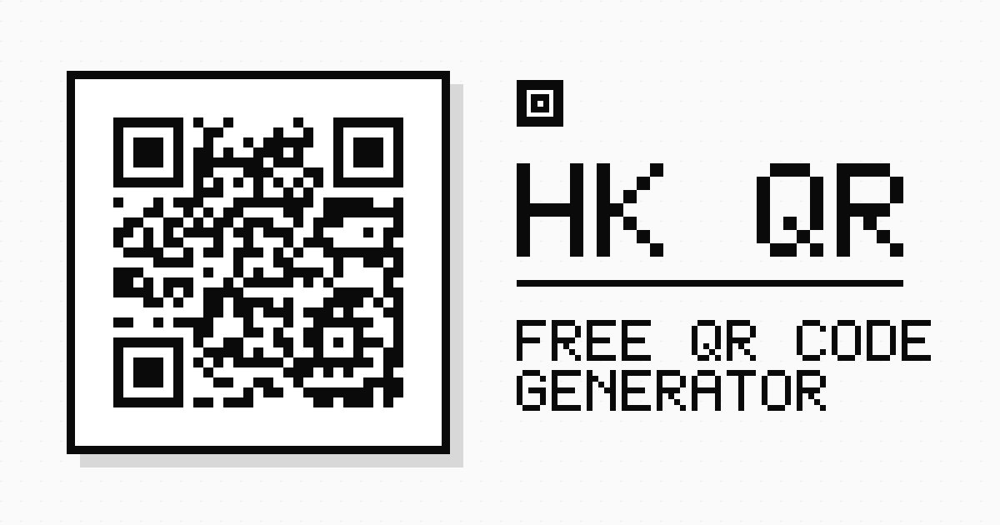

# HK QR — Free QR Code Generator

A fast, private, browser-only QR code generator. Paste a link, style the code, add a logo, and export a print-ready PNG up to **3000 × 3000 px** — no signup, no watermarks, no uploads.



---

## Table of contents

- [Features](#features)
- [Tech stack](#tech-stack)
- [Project structure](#project-structure)
- [Getting started](#getting-started)
- [Available scripts](#available-scripts)
- [How it works](#how-it-works)
- [Customization](#customization)
- [SEO](#seo)
- [Deployment](#deployment)
- [Privacy](#privacy)
- [Browser support](#browser-support)
- [Troubleshooting](#troubleshooting)
- [Contributing](#contributing)
- [License](#license)

---

## Features

### QR generation

- **Three content types** — **URL** (with automatic `https://` prefixing), plain **Text**, and **Wi-Fi** (encodes a `WIFI:T:...` join payload that phone cameras scan to connect).
- **Live preview** — the QR code regenerates as you type, with a subtle progress indicator while the matrix is compiled.
- **URL validation** — a visual indicator confirms a valid URL structure and offers one-click test presets (Google, GitHub, Wikipedia).

### Styling

- **Foreground colors** — 6 presets (Obsidian, Cobalt Blue, Emerald Green, Crimson Red, Amethyst, Amber Orange) plus a native color picker.
- **Background colors** — 4 presets (White, Alabaster, Soft Cream, Ice Cyan) plus a native color picker.
- **Export sizes** — 350 px (web), 750 px (print standard), 1500 px (poster), and 3000 px (billboard) square PNGs.
- **Error correction** — ISO/IEC 18004 levels L (7%), M (15%), Q (25%), and H (30%).
- **Dark and light UI themes** — persisted in local storage and initialized from the OS preference.

### Logos and center badges

- **13 built-in vector icons** — Globe, Link, Star, Heart, Magic, Shield, Wi-Fi, Mail, Coffee, Store, GitHub, YouTube, and Instagram.
- **Custom upload** — drag and drop or browse for PNG, JPG, SVG, or WebP files up to 5 MB.
- **Badge controls** — rounded, circle, or square shape; compact (18%), default (22%), or prominent (26%) size.
- **Badge theming** — match the pattern background or force white/black, and choose an icon tone that always keeps contrast.
- **Automatic safety** — enabling a logo automatically raises error correction to **level H**, so the code stays scannable.

### Export and sharing

- **Download PNG** — filenames are derived from the destination hostname (for example `github_matrix_750x750.png`).
- **Download SVG** — the same matrix (colors, quiet zone, and center badge) exported as a scalable vector via `src/utils/qrSvg.ts`.
- **Copy to clipboard** — copies the PNG image directly; falls back to copying the URL text when image clipboard access is unavailable.
- **Web Share API** — shares the image file where supported, then falls back to sharing the link, then to copying it.

### History and privacy

- **Recent history** — the last 5 exported codes are stored in `localStorage` with their colors, size, error correction, and logo settings (history is recorded on export, not on every keystroke).
- **Wi-Fi codes are never saved** — history only stores URL and text codes; Wi-Fi payloads embed the network password, so they are excluded from history (and any previously stored Wi-Fi entries are purged on load).
- **Restore in one click** — click any history item to reload its exact configuration.
- **Per-item actions** — copy or share the destination link, remove a single entry, or clear the entire history.
- **Fully local** — QR codes are generated in the browser with Canvas. Nothing is sent to a server.

### SEO and accessibility

- Static metadata, Open Graph/Twitter cards, canonical URL, and JSON-LD (`WebApplication` + `FAQPage`) generated at build time from `src/data/content.ts`.
- Crawlable below-the-fold content: feature grid, how-to steps, and FAQ — the same copy that feeds the JSON-LD.
- Semantic landmarks, ARIA labels, keyboard-closable history drawer, and descriptive image alt text.

---

## Tech stack

| Layer | Technology |
|---|---|
| UI | [React 19](https://react.dev/) + TypeScript |
| Build tool | [Vite 6](https://vite.dev/) |
| Styling | [Tailwind CSS 4](https://tailwindcss.com/) via `@tailwindcss/vite` |
| QR encoding | [`qrcode`](https://www.npmjs.com/package/qrcode) |
| Icons | [`lucide-react`](https://lucide.dev/) |
| Animation | [`motion`](https://motion.dev/) |
| SEO asset generation | Node.js + [`pngjs`](https://www.npmjs.com/package/pngjs) |

> The app itself is a static client-side SPA — no server, no API keys, no runtime environment variables. `express`, `dotenv`, `@google/genai`, `esbuild`, `tsx`, and `autoprefixer` were removed from the original AI Studio scaffold; `npm audit` reports 0 vulnerabilities.

---

## Project structure

```text
qr/
├── index.html                     # HTML shell, meta tags, OG/Twitter cards, JSON-LD markers
├── package.json                   # Dependencies and scripts (package-lock.json is the only lockfile)
├── package-lock.json
├── tsconfig.json                  # TypeScript configuration
├── vite.config.ts                 # Vite + React + Tailwind plugins, seoJsonLd(), Vitest config
├── vercel.json                    # Deployment security headers (nosniff, X-Frame-Options, ...)
├── .github/workflows/ci.yml       # CI: npm ci → audit → lint → test → build on Node 20/22 (push/PR to main)
├── .github/dependabot.yml         # Weekly dependency updates (npm + github-actions)
├── LICENSE                        # Apache-2.0
├── SEO.md                         # SEO implementation notes and launch checklist
├── README.md
├── public/
│   ├── favicon.svg                # Scalable brand favicon
│   ├── favicon.png                # 64×64 PNG fallback
│   ├── apple-touch-icon.png       # 180×180 iOS icon
│   ├── og-image.png               # 1200×630 social preview with a real QR code
│   ├── robots.txt                 # Crawler rules + sitemap reference
│   └── sitemap.xml                # Single-URL sitemap
├── scripts/
│   └── generate-seo-assets.mjs    # Regenerates favicon, touch icon, and OG image (SITE_URL)
└── src/
    ├── main.tsx                   # React entry point
    ├── index.css                  # Tailwind import, theme fonts, scrollbar styles
    ├── App.tsx                    # State, generation, export, and history logic
    ├── types.ts                   # Shared TypeScript interfaces (ContentType, WifiConfig, ...)
    ├── data/
    │   ├── content.ts             # Single source of truth for features/steps/FAQ + JSON-LD builders
    │   └── presets.ts             # Color, size, and URL presets
    ├── components/
    │   ├── SiteHeader.tsx         # Brand, nav, history toggle, theme switcher
    │   ├── GeneratorPanel.tsx     # Content-type tabs, URL/Text/Wi-Fi forms, colors, sizes, ECC
    │   ├── PreviewPanel.tsx       # Preview + Download PNG / SVG / Copy / Share actions
    │   ├── SeoSections.tsx        # Below-the-fold features / how-to / FAQ (from data/content.ts)
    │   ├── StatusBar.tsx          # Thin status strip
    │   ├── SiteFooter.tsx         # Brand line and internal anchor links
    │   ├── LogoSelector.tsx       # Preset icons, upload, badge shape/size/color controls
    │   └── HistorySidebar.tsx     # Recent history slide-over drawer
    ├── test/
    │   ├── setup.ts               # Vitest setup (in-memory localStorage, jest-dom, cleanup)
    │   └── fixtures.ts            # Shared test fixtures (Wi-Fi configs, URL input)
    └── utils/
        ├── qrGenerator.ts         # QR encoding + center badge canvas compositing (PNG)
        ├── qrSvg.ts               # QR matrix → scalable SVG string (SVG export)
        ├── qrContent.ts           # Content-type payload building (URL auto-prefix, text, Wi-Fi)
        ├── presetLogos.ts         # Preset SVG definitions and contrast helpers
        └── storage.ts             # try/catch-wrapped localStorage get/set/remove
```

---

## Getting started

### Prerequisites

- **Node.js `^20.19.0`, `^22.13.0` or newer** (the `engines` field in `package.json` matches Vitest's and jsdom's Node requirements and what CI runs)
- npm (`package-lock.json` is the only lockfile in the repo)

### Install and run

```bash
# 1. Install dependencies
npm install

# 2. Start the dev server on http://localhost:3000
npm run dev
```

No API key or `.env` file is needed — generation is entirely client-side and the app reads no environment variables at all.

### Production build

```bash
npm run build     # outputs static files to dist/
npm run preview   # serves the production build locally
```

---

## Available scripts

| Script | Command | Description |
|---|---|---|
| `dev` | `vite --port=3000 --host=0.0.0.0` | Start the dev server on port 3000, exposed on the network |
| `build` | `vite build` | Create an optimized production build in `dist/` |
| `preview` | `vite preview` | Preview the production build locally |
| `lint` | `tsc --noEmit` | Type-check the project without emitting files |
| `test` | `vitest run` | Run the unit and component test suite once |
| `test:watch` | `vitest` | Run the tests in watch mode |
| `assets:seo` | `node scripts/generate-seo-assets.mjs` | Regenerate favicon, Apple touch icon, and OG image |
| `clean` | `rm -rf dist server.js` | Remove build artifacts (requires a POSIX-compatible shell) |

### Tests and CI

The suite (Vitest + Testing Library + jsdom) covers the payload builders, the SVG exporter, preset-logo contrast helpers, and component behavior — including that Wi-Fi codes are never written to history and that the app still renders when `localStorage` throws:

```bash
npm test
```

GitHub Actions (`.github/workflows/ci.yml`) runs `npm ci` → `npm run lint` → `npm test` → `npm run build` on every push and pull request to `main`.

---

## How it works

### Generation pipeline

1. **Input normalization** — `buildQrContent()` in `src/utils/qrContent.ts` picks the payload for the active content type: URLs get `https://` prefixed when the protocol is missing, text is encoded raw, and the Wi-Fi form is serialized into a `WIFI:T:...;S:...;P:...;;` payload (with reserved characters escaped).
2. **Matrix encoding** — `generateQrCode()` in `src/utils/qrGenerator.ts` calls `QRCode.toDataURL()` with the selected size, colors, margin (`3` modules), and error-correction level.
3. **Logo compositing** — when a logo is active, a canvas of the requested size is created, the base QR is drawn onto it, and a badge is rendered in the center:
   - The badge background clears the modules underneath.
   - The shape is drawn as a circle, rounded rectangle, or square with a high-contrast hairline border.
   - The icon is aspect-fit and clipped to the badge shape.
4. **Result** — the canvas is exported as a PNG data URL and rendered in the preview. Errors are surfaced in the UI instead of failing silently.

### Error correction and logos

A logo covers part of the matrix, so the encoder automatically uses **level H (30% redundancy)** whenever a logo is enabled. This happens in two places:

- `handleLogoChange()` in `App.tsx`, which updates the visible setting.
- `generateQrCode()`, which enforces it again at encode time as a safety net.

### Persistence

All `localStorage` access goes through the safe wrappers in `src/utils/storage.ts` (`storageGet` / `storageSet` / `storageRemove`), each wrapped in try/catch — storage being blocked, full, or unavailable never breaks the UI.

| Key | Contents |
|---|---|
| `hk_qr_theme` | `"light"` or `"dark"` |
| `hk_qr_history` | JSON array of up to 5 `QrHistoryItem` objects |

History entries store the content type, payload, timestamp, foreground/background colors, size, error-correction level, and full logo configuration. The generator starts with the production URL (`DEFAULT_URL` in `src/data/presets.ts`) and an **empty history** — an entry is recorded only after a successful export (Download PNG, Download SVG, Copy, or Share), never while typing, and duplicates are de-duplicated case-insensitively for URLs and case-sensitively for text. **Wi-Fi codes are never persisted**: entries typed `wifi` (or legacy entries whose payload starts with `WIFI:`) are skipped on save and purged from existing stored history on load, so network passwords are not kept in the browser.

### Contrast helpers

`src/utils/presetLogos.ts` includes:

- `getLuminance(hex)` — perceptual luminance from a hex color.
- `getHighContrastColor(bg, desired?)` — keeps the requested color when the luminance difference is at least `0.3`, otherwise returns black or white.
- `resolvePresetIconColor()` — picks a safe icon color from the badge background, the user's preference, or the matrix color.
- `createPresetSvgDataUri()` — builds an inline SVG data URI for preset icons.

---

## Customization

### Adding a preset logo

1. Add an entry to `PRESET_LOGOS` in `src/utils/presetLogos.ts` with a unique `id`, `name`, `type` (`"stroke"` or `"fill"`), `viewBox`, and inner SVG `elements`.
2. It appears automatically in the `LogoSelector` grid — no other changes required.

### Changing colors or sizes

Preset palettes and export sizes live in `src/data/presets.ts`:

- `FOR_COLOR_PRESETS` — foreground swatches
- `BACK_COLOR_PRESETS` — background swatches
- `SIZE_PRESETS` — export dimensions
- `TEST_PRESETS` — quick URL examples

### Fonts and theme

Fonts are loaded in `index.html` (with `preconnect`) and mapped to Tailwind tokens in `src/index.css`:

- `--font-sans`: Inter
- `--font-display`: Outfit
- `--font-mono`: JetBrains Mono

Dark mode uses the `dark` class on `<html>` via `@custom-variant dark`.

---

## SEO

The repository ships with a complete on-page SEO setup. The production domain is **`https://freesubqr.vercel.app`**, set in four places:

| File | What to update when the domain changes |
|---|---|
| `index.html` | `<link rel="canonical">` (the single source of truth — `og:url`, `og:image`, and `twitter:image` live here too) |
| `public/robots.txt` | `Sitemap:` URL and the comment |
| `public/sitemap.xml` | `<loc>` (and `<lastmod>`) |
| `scripts/generate-seo-assets.mjs` | `SITE_URL` constant |

Find every occurrence (PowerShell):

```powershell
Select-String -Path index.html,public\robots.txt,public\sitemap.xml,scripts\*.mjs -Pattern "freesubqr"
```

Then regenerate the social image and icons — the OG image embeds a real QR code of `SITE_URL`:

```bash
npm run assets:seo
```

### Structured data and copy

- The crawlable copy — feature grid, how-to steps, and FAQ — lives in **one place**: `src/data/content.ts`.
- `src/components/SeoSections.tsx` renders that copy on the page.
- The **`seoJsonLd()` Vite plugin** in `vite.config.ts` reads the same file at build time and injects the `WebApplication` and `FAQPage` JSON-LD blocks between the `JSON-LD:START` / `JSON-LD:END` markers in `index.html`, taking the site URL from the canonical tag. Edit the copy in `content.ts` once and the page and structured data stay in sync automatically — there is no second copy of the FAQ to maintain.

See [`SEO.md`](SEO.md) for the full pre-launch and post-launch checklist (Search Console, Bing, rich results, social previews, Core Web Vitals).

---

## Deployment

The build output in `dist/` is fully static and can be hosted anywhere:

- Netlify, Vercel, Cloudflare Pages, GitHub Pages
- Amazon S3 + CloudFront
- Nginx, Apache, or any static file server

```bash
npm ci
npm run build
# deploy the contents of dist/
```

Notes:

- The app is a single page with no client-side router, so no SPA rewrite rules are required.
- If you deploy under a subpath (for example `https://your-domain.com/qr/`), set Vite's [`base`](https://vite.dev/config/shared-options.html#base) option in `vite.config.ts` and update the absolute asset paths in `index.html`.
- After any domain change, update the four files listed in [SEO](#seo) and rerun `npm run assets:seo` before deploying.

---

## Privacy

- QR codes are generated locally with the Canvas API; no content is uploaded.
- The only persisted data is the theme preference and up to five recent history entries, both in `localStorage` (accessed through failure-proof wrappers — see `src/utils/storage.ts`).
- **Wi-Fi codes are never saved to history**, so network passwords are not stored in your browser; previously stored Wi-Fi entries are purged on load.
- History can be cleared at any time from the History drawer.
- There are no analytics or tracking scripts in the project by default.

---

## Browser support

Modern evergreen browsers:

| Feature | Requirement |
|---|---|
| App | Chrome, Edge, Firefox, Safari (current versions) |
| PNG download | `<a download>` support |
| Copy image | Clipboard API with `ClipboardItem` (falls back to copying the URL) |
| Share image | Web Share API Level 2 (falls back to sharing/copying the URL) |
| Canvas badge rendering | `CanvasRenderingContext2D`, with a `roundRect` fallback |

---

## Troubleshooting

**The dev server is not reachable on port 3000.**
Another process may be using the port. Stop it or run `npx vite --port 3001`.

**`npm run clean` fails on Windows.**
The script uses `rm -rf`, which needs Git Bash, WSL, or a POSIX shell. Delete `dist/` manually or run it from Git Bash.

**The logo does not appear in the exported PNG.**
Make sure the image is under 5 MB and is a PNG, JPG, SVG, or WebP file. Cross-origin images can taint the canvas; upload the file instead of linking to a remote URL.

**The QR code will not scan after heavy customization.**
Keep a strong contrast between foreground and background, avoid very light foreground colors, and leave a quiet zone around the code. When a logo is enabled, level H is enforced automatically.

**Social previews show the wrong domain.**
Make sure the canonical/`og:url` in `index.html`, `public/robots.txt`, `public/sitemap.xml`, and `SITE_URL` in `scripts/generate-seo-assets.mjs` all match, then run `npm run assets:seo` and redeploy.

**Type errors after changing dependencies.**
Run `npm run lint` (`tsc --noEmit`) to see the full diagnostics.

---

## Contributing

1. Fork the repository.
2. Create a feature branch: `git checkout -b feature/my-change`.
3. Make your changes and run `npm run lint`, `npm test`, and `npm run build` (the same checks CI runs).
4. Open a pull request with a clear description of the change.

Please keep the existing design language, TypeScript types, and accessibility attributes consistent with the rest of the codebase.

---

## License

Licensed under the **Apache License, Version 2.0** — see [`LICENSE`](LICENSE) for the full text. Source files carry the matching `SPDX-License-Identifier: Apache-2.0` header.

---

## Acknowledgements

- [qrcode](https://github.com/soldair/node-qrcode) for QR encoding
- [Lucide](https://lucide.dev/) for the icon set
- [Motion](https://motion.dev/) for animations
- [Tailwind CSS](https://tailwindcss.com/) and [Vite](https://vite.dev/) for the toolchain
